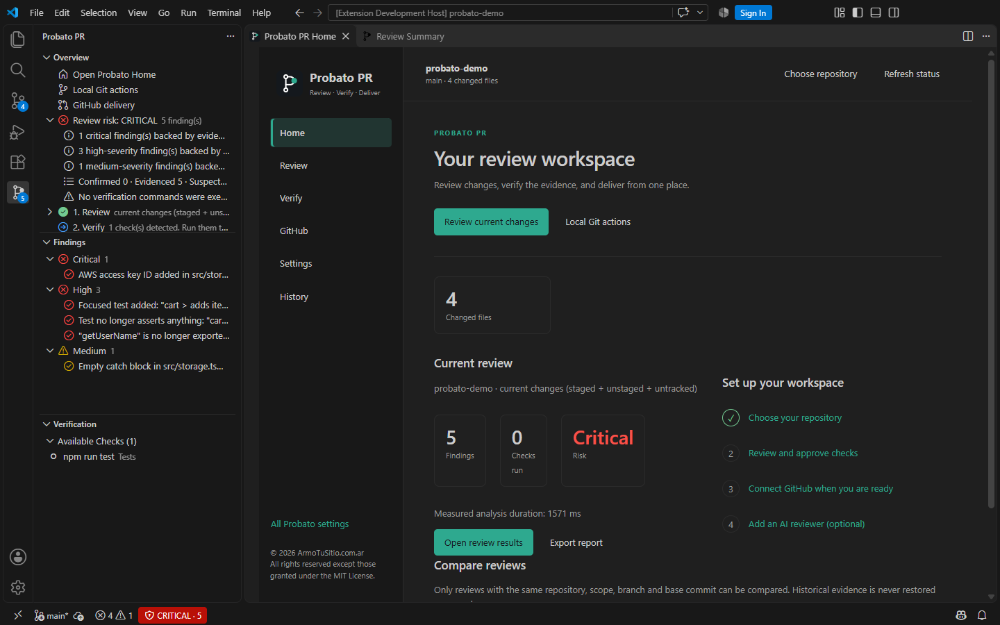
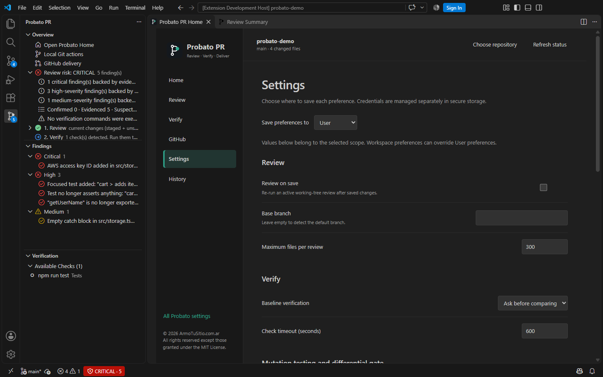
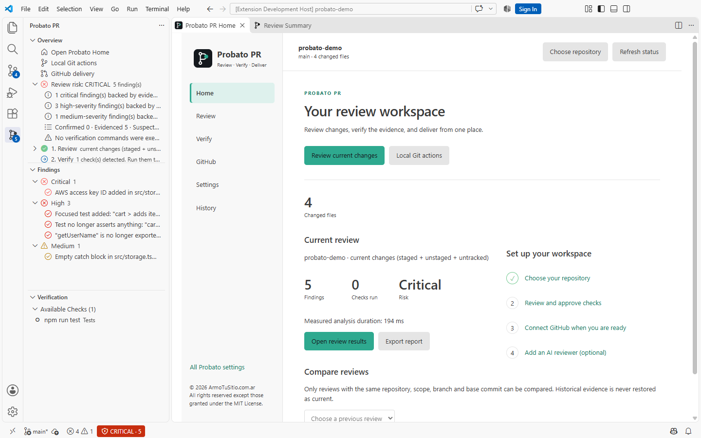
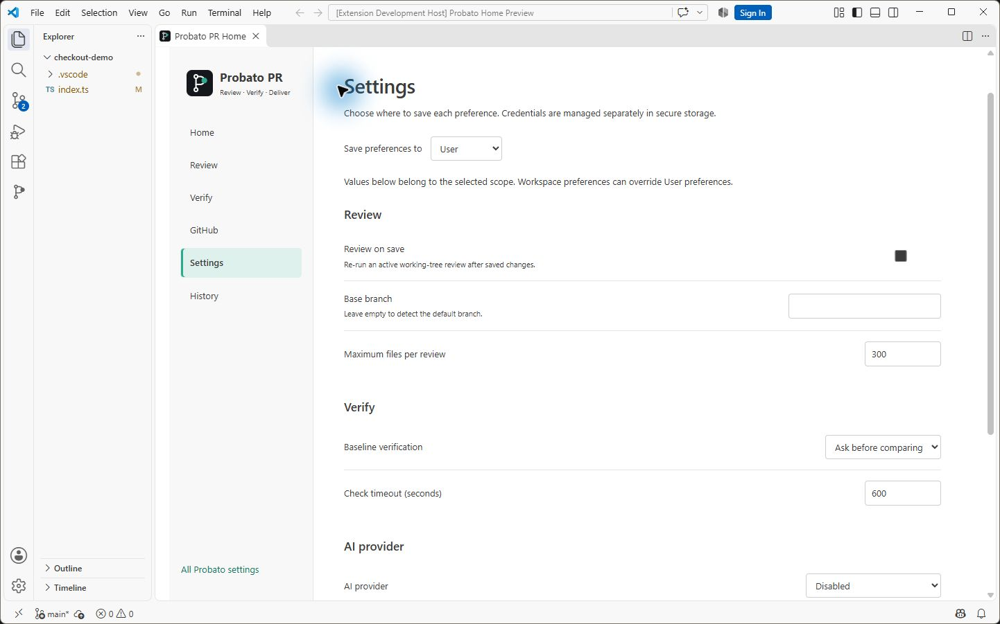

<p align="center">
  
</p>

<h1 align="center">Probato PR</h1>

<p align="center"><strong>Code review with proof.</strong><br>Your AI reviews the code. We verify what could break.</p>

Probato PR reviews your Git changes and pull requests inside VS Code and tells you **what is proven, what is only
suspected, and why**. It runs deterministic analyzers locally, can execute your project's own checks with your approval,
and compares results against the base revision to tell a regression *introduced by your change* from a failure that was
already there. Version 0.4 brings a persistent control center: configure your workspace, review changes,
verify evidence and deliver pull requests from the editor.

No account, no AI key, no server, no subscription is needed for the core review. When you want more, **bring your own
AI**: GitHub Copilot, Claude, OpenAI or a local model.

## Control center

Open **Probato PR → Open Probato Home** from the sidebar or Command Palette. Home stays in one editor tab
and brings together repository status, review scopes, verification, GitHub delivery, and local review history.
The first sidebar visit opens Home automatically; turn this off in **Settings → Open Home on startup**.

Use **Settings** inside Home to adjust review and verification preferences at the **User** or **Workspace**
level. AI credentials remain in the existing secure connection flow. Reviewing, running checks, and publishing
continue to use their existing approval steps. In a multi-root workspace, choose the repository for local reviews;
Git and GitHub delivery retain their own repository selection.

## Proof-driven review in 0.5

Each finding now explains its reported observation, linked evidence, relevant executed checks and what still
needs to be proved. Compare compatible reviews from History to distinguish newly observed, persisting and
no-longer-observed findings. Disappearance alone never means a defect is resolved.

TypeScript contract analysis follows supported symbols through aliases and reexports using an in-memory,
snapshot-only compiler. The analysis worker keeps compiler work outside the extension host. Unsupported or
incomplete graphs fall back conservatively and disclose their limits.

Verification recommendations explain which existing checks relate to changed projects. The full plan remains
available and recommendations never approve execution. Repository policies in `.probato.yml` can adjust supported
rule severities and recommend existing checks; they cannot define commands, grant approval or lower protected
critical or secret findings. See the [upgrade guide](docs/UPGRADE-0.5.md).

**Optional mutation testing** uses a locally installed Stryker on impacted JavaScript/TypeScript source.
Execution, verification, quality trend and gate decision are independent. A decrease from 85% to 78% is a
**7 percentage point regression**, even when both scores exceed 75%, only when the measurements are comparable.
Stryker is not installed or run by ordinary reviews. See [Mutation Testing](docs/MUTATION_TESTING.md) for setup,
score definitions, approval and resource limits, baseline requirements and reproducible validation.

## Why Probato PR

Most AI review tools return a list of opinions. Probato PR classifies every finding by the strength of its evidence:

| Status | Meaning |
|---|---|
| **Confirmed** | An executed check proves the defect, and a base-vs-head comparison attributes it to this change. |
| **Evidenced** | Objective technical evidence exists (an AST fact, a failing check), but causality is not fully proven. |
| **Suspected** | Probable issue from heuristics or AI. Not backed by an executed check. |
| **Not verified** | The verification this finding needs could not be performed — and the report says why. |

An AI claim stays suspected. Executed tool diagnostics are reported independently and become confirmed only
when a comparable baseline establishes the regression. A compiler error at the same location does not prove
an unrelated AI hypothesis.

## See version 0.4 in action

Home brings repository status, the current review and setup steps into one persistent editor tab.
The original Probato PR logo and green accent remain consistent with your editor theme.



Choose User or Workspace settings to configure reviews, baseline comparison, timeouts and optional AI.
Each scope shows its own values; workspace preferences can override user preferences.



The same control center adapts to light themes, including navigation, text, controls and the brand accent.





*Real screenshots of version 0.4.0 in English, using a local demonstration repository.
No GitHub account is connected and no code is published during these captures.
Probato PR also includes Spanish translations.*

## Quick start

1. Install **Probato PR** from the Extensions view.
2. Open a folder that is a Git repository and **trust** the workspace.
3. Open the **Probato PR** view in the Activity Bar. **Home** opens on the first visit; you can return with
   **Open Probato Home**. Choose your repository and click **Review current changes**. You can also start a review
   from Source Control or the Command Palette.
4. The **Review Summary** opens with the review risk, the findings and the next step highlighted. Click a finding to
   open the code beside it. Findings also appear in the **Problems** panel, where the light bulb lets you dismiss a
   finding, open its evidence or jump to the summary.
5. **Verify:** run your project's type-check, lint, tests or build. You choose exactly which commands run, and you can
   choose **Run and remember** so the same checks run without asking next time in that repository, while the repository
   content and execution definitions remain unchanged.
6. **Deliver:** use **Local Git Actions** to stage, commit and push. Review the committed branch, then open
   **GitHub Delivery** to create or update a PR, publish selected findings, follow CI and merge. Sign in to GitHub
   when requested. You can also copy the PR description or export Markdown, SARIF or JSON.
7. Optional: **Connect Your AI** to add a second opinion and a written walkthrough of the change (see below).

New to Probato PR? Run `Welcome: Open Walkthrough` and pick **Get started with Probato PR**.

## Complete GitHub delivery

Use **Probato PR: GitHub Delivery** to create or update pull requests, publish selected findings, manage reviews
and conversations, follow CI, read job logs and merge with an expected commit and destination. **Local Git Actions**
handles branches, staging, commits, pushes and fast-forward synchronization. Every write presents its destination
and content before execution. See the [delivery guide](docs/DELIVERY.md) for the full workflow and CLI.

## Features

- **Review scopes:** current changes (staged + unstaged + untracked), staged changes, a branch against its merge base, a
  single commit, or a GitHub pull request.
- **Deterministic analyzers (no AI):**
  - *Contracts* (TypeScript/JavaScript AST): removed or renamed exports still imported elsewhere, new required
    parameters with stale call sites, removed enum members and interface properties still in use, deleted or moved
    modules still imported.
  - *Test integrity:* deleted test files, removed cases, `.only` / `.skip` / `xit`, tests whose assertions were removed
    (AST), Go `t.Skip` and removed `TestXxx` functions.
  - *Secrets:* known credential formats on added lines, sensitive files (`.env`, keys, certificates) added to Git.
    Excerpts are always redacted.
  - *Error handling:* new empty `catch` blocks, swallowed promise rejections, new `@ts-ignore` / `@ts-nocheck` /
    `eslint-disable`.
  - *Dependencies:* new or changed install scripts (`postinstall`…), major upgrades, packages removed but still
    imported, local `replace` directives in `go.mod`.
  - *Configuration:* TypeScript strictness disabled, risky GitHub Actions triggers (`pull_request_target` + PR head
    checkout, `write-all`).
- **Verification engine:** detects checks already present in your project, shows the exact commands, runs only what you
  approve, captures evidence (command, revision, exit code, duration, output hash, redacted output), and re-runs failing
  checks on the base revision in a temporary Git worktree to attribute failures. Compiler and linter errors are linked
  as independent findings; a comparable baseline can make that executed diagnostic **confirmed**.

  | Ecosystem | Detected from | Checks |
  |---|---|---|
  | JavaScript / TypeScript | `package.json`, `tsconfig.json` | `typecheck`, `lint`, `test`, `build` scripts; local `tsc` |
  | Go | `go.mod` | `go build`, `go vet`, `go test` |
  | PHP | `composer.json` | Composer scripts, or PHPStan, PHP_CodeSniffer, PHPUnit and Pest from `vendor/bin` |
  | Python | `pyproject.toml`, `setup.cfg`, `requirements.txt`… | mypy, ruff and pytest when configured, with the project's virtual environment (`.venv`, `venv`, `env`) |
  | Rust | `Cargo.toml` | `cargo check`, `cargo clippy`, `cargo test` |
  | Java / Kotlin | `pom.xml`, `build.gradle(.kts)` | Maven `compile` / `test`, Gradle `assemble` / `test`, through `mvnw` / `gradlew` when present |

- **Guided Review → Verify → Deliver flow:** the Review Summary panel, the Overview view and the status bar always show
  the same step states and the next action. Findings can be filtered by severity and grouped by severity or by file; the
  Activity Bar badge shows how many are open.
- **Explainable review risk:** a label (`LOW` … `CRITICAL`) with the reasons and the limitations behind it. Passing
  checks never mean "safe".
- **Reports:** Markdown, SARIF 2.1.0 (GitHub code scanning compatible) and full JSON with evidence.
- **Pull request description:** one click copies a Markdown description with the review risk, the executed checks and
  the top findings, plus the AI walkthrough when you ran one.
- **Monorepos:** discover checks in nested project roots; execute staged and historical checks in isolated worktrees.
- **Cross-stack hints:** OpenAPI JSON/YAML and TypeScript DTO properties, SQL column references and tenant-filter
  removals. Inferred relationships remain suspected.
- **External evidence:** import SARIF without accepting external claims of causal confirmation.
- **Incremental review:** opt-in review on save with a bounded, content-aware in-memory analyzer cache.
- **CLI for CI:** the same review engine with severity exit codes and explicitly authorized checks.
- **Bring your own AI (optional):** see the next section.

## Bring your own AI

Probato PR works without AI. Connecting one adds a second opinion on the change and a written walkthrough for the pull
request description. Run **Probato PR: Connect Your AI** (or click *Connect Your AI* in the Review Summary): pick a
provider, enter your key, and choose a model from the provider's own list. Listing the models also checks the
connection, without spending tokens.

| Provider | What you need |
|---|---|
| Chat models already in VS Code | GitHub Copilot or another installed chat model provider. No API key. |
| Anthropic Claude | Your Anthropic API key. |
| OpenAI | Your OpenAI API key. |
| Any OpenAI-compatible API | A base URL and, if the server needs one, a key: OpenRouter, Azure OpenAI, Ollama, LM Studio… |

What the AI receives, and the guarantees around it:

- **You confirm every time.** Before each AI review, a dialog lists the files whose diff is sent, the files whose full
  content is added for context, and the files left out with the reason.
- **Context:** the diffs first, then the full current content of changed files while `probatoPR.ai.maxContextChars`
  allows (turn it off with `probatoPR.ai.includeFileContent`), plus what Probato PR already found so the model does not
  repeat it.
- **Never sent:** sensitive files (`.env*`, keys, certificates, credentials) and your `probatoPR.ai.exclude` globs.
  Detected secrets are redacted.
- **Keys** live in your OS keychain (VS Code SecretStorage), each one bound to the server it was entered for. The base
  URL is a user-level setting, so a repository's workspace settings cannot redirect your key. HTTPS is required except
  for servers on your own machine.
- **AI output is untrusted.** It is parsed against a schema; findings and walkthrough entries pointing at files or lines
  outside the shared diff are rejected; nothing in a response is ever executed. AI findings stay *suspected*. Executed
  diagnostics are reported separately with their own evidence and attribution.

## Requirements

- VS Code 1.99 or newer, desktop (local, WSL or remote hosts with a local file system).
- Git on `PATH`.
- For verification: your project's tools already installed. Probato PR never runs an install command; build tools
  may download dependencies as part of an explicitly approved check.

## Supported languages

| Level | Languages |
|---|---|
| Diff review, secrets, configuration | Any text file |
| AST analysis (contracts, tests, error handling) | TypeScript, JavaScript (incl. TSX/JSX, ESM/CJS) |
| Line-level test checks, `go.mod` checks | Go |
| Verification (executes your tools) | Node.js, Go, PHP, Python, Rust, Java and Kotlin; nested projects in monorepos |

OpenAPI JSON/YAML, TypeScript DTOs, SQL migrations and tenant-filter removals also have conservative cross-stack
checks. Their inferred relationships remain suspected. Parser-based PHP/Python/Java semantic analysis and
Docker/Terraform checks remain future work; executing a language tool is separate from analyzing its semantics.

## Commands

| Command | Description |
|---|---|
| `Probato PR: Local Git Actions` | Create/switch branches, stage, commit, push, synchronize or delete a merged local branch. |
| `Probato PR: GitHub Delivery` | Open the complete PR workflow, including conversations, reviews and merge queue. |
| `Probato PR: Create or Update Pull Request` | Preview and publish a draft PR or update its description. |
| `Probato PR: Publish Selected Findings` | Preview and publish selected observations on valid PR diff locations. |
| `Probato PR: Pull Request and CI Status` | Inspect CI results, blockers and GitHub Actions logs. |
| `Probato PR: Merge Pull Request` | Refresh requirements and merge the expected commit after confirmation. |
| `Probato PR: Import SARIF Evidence` | Add external diagnostics without claiming a verified execution. |
| `Probato PR: Review Current Changes` | Staged, unstaged and untracked changes vs `HEAD`. |
| `Probato PR: Review Staged Changes` | Index vs `HEAD`. |
| `Probato PR: Review Branch` | `HEAD` vs merge base with the base branch. |
| `Probato PR: Review Commit` | One commit vs its parent. |
| `Probato PR: Review Pull Request (GitHub)` | Read-only, from the GitHub API. |
| `Probato PR: Verify Findings (Run Checks)` | Plan, approve and run project checks with baseline attribution. |
| `Probato PR: AI Review (Optional)` | Send the reviewed change to your AI after confirmation: second-opinion findings and a pull request walkthrough. |
| `Probato PR: Connect Your AI` | Choose an AI provider, store its key and pick the model. |
| `Probato PR: Delete Stored AI API Keys` | Removes every AI key Probato PR stored. |
| `Probato PR: Forget Approved Checks` | Asks again before running any check that you chose to remember. |
| `Probato PR: Show Review Summary` | Opens the Review Summary panel: risk, next step, findings and checks. |
| `Probato PR: Copy PR Description` | Copies a pull request description: AI walkthrough (if any), risk, checks and top findings. |
| `Probato PR: Export Review Report` | Markdown, SARIF or JSON. |
| `Probato PR: Open Markdown Report (for the PR Description)` | Markdown preview of the review, ready to paste into a pull request. |
| `Probato PR: Cancel` | Stops the running operation and its child processes. |
| `Probato PR: Delete Local Review History` | Removes stored reviews for this workspace. |

## Configuration

| Setting | Default | Description |
|---|---|---|
| `probatoPR.review.baseBranch` | `""` | Base for branch reviews; empty = `origin/HEAD`, then `main`/`master`. |
| `probatoPR.review.onSave` | `false` | Re-review current changes on save; never auto-run checks or send data to AI. |
| `probatoPR.review.maxFiles` | `300` | Files analyzed per review; extra files are listed as skipped. |
| `probatoPR.review.maxDiffBytes` | `4000000` | Maximum diff size read from Git. |
| `probatoPR.review.exclude` | lockfiles, `dist`, `node_modules`… | Globs not analyzed. |
| `probatoPR.verification.timeoutSeconds` | `600` | Per-command timeout. |
| `probatoPR.verification.maxOutputBytes` | `1000000` | Output kept per command (tail). |
| `probatoPR.verification.baseline` | `ask` | Re-run failing checks on the base revision: `ask`, `always`, `never`. |
| `probatoPR.ai.provider` | `none` | `none`, `vscode-lm`, `anthropic`, `openai-compatible`. Set it with **Connect Your AI**. |
| `probatoPR.ai.anthropicModel` | `claude-opus-5-5` | Model for the Anthropic provider. |
| `probatoPR.ai.vscodeLmModel` | `""` | VS Code chat model (`vendor/id`); empty = first available. |
| `probatoPR.ai.openaiCompatible.baseUrl` | `https://api.openai.com/v1` | OpenAI-compatible API URL. User-level only. |
| `probatoPR.ai.openaiCompatible.model` | `""` | Model ID for the OpenAI-compatible API. |
| `probatoPR.ai.includeFileContent` | `true` | Also send the full content of changed files for context. |
| `probatoPR.ai.maxContextChars` | `120000` | Characters of repository data (diffs + file content) sent per AI review. |
| `probatoPR.ai.exclude` | `[]` | Extra globs never sent to AI (sensitive files are always excluded). |

## Command line

Build with `pnpm run build:prod`, then use the same engine outside the editor:

```bash
node dist/cli.cjs --scope branch --base origin/main --format sarif --output /tmp/probato.sarif
node dist/cli.cjs --list-checks
node dist/cli.cjs --verify script:typecheck --baseline --format json
```

Choose a suitable temporary output path on Windows. Checks execute only when explicitly selected with `--verify`;
`--baseline` also authorizes the base comparison. Exit codes are 0 below the finding threshold, 1 when the threshold
is reached and 2 for execution/configuration errors. See the [delivery guide](docs/DELIVERY.md) for all options.

## Offline mode

Local review and reports work offline. GitHub delivery, remote Git operations and AI review need their respective
services. Approved project checks may use the network themselves. Service failures do not prevent local review.

## Security and privacy

- Works only in **trusted workspaces**; Restricted Mode disables it, as VS Code requires for tools that run processes.
- Read-only by default: reviews never modify your files. Verification commands run **only after explicit approval** and
  run with your normal user permissions — **they are not sandboxed**. A remembered approval is stored outside the
  repository and bound to its content snapshot, command, scripts and configuration. Repository changes require approval
  again.
- Git is invoked with repository-config execution paths disabled (fsmonitor, external diff, textconv, hooks for the
  baseline worktree).
- Secrets are redacted from stored evidence, reports and AI context. API keys live in VS Code SecretStorage, bound to
  the server they were entered for.
- No telemetry. GitHub delivery uses the GitHub API; push and synchronization use Git remotes. AI review requires a
  confirmation listing the shared files. Approved project checks can make their own network requests.

Details: `SECURITY.md` · `PRIVACY.md`.

## Known limitations

- Cross-file contract analysis resolves relative imports and the root `tsconfig.json` `baseUrl`/`paths` aliases;
  `extends` chains and package-name self-imports are not followed yet (a passing type-check automatically downgrades
  such findings to *suspected*).
- Baseline runs link `node_modules` from your checkout; monorepos with per-package `node_modules` may produce
  inconclusive baselines.
- For PHP and Python, `vendor/` and virtual environments are deliberately **not** linked into the baseline: a Composer
  autoloader or an editable install would load the changed code instead of the base revision and produce a false
  attribution. Failures are reported as inconclusive instead. Rust and Java builds run from scratch in the baseline
  worktree, which is correct but slower.
- Checks are detected at repository and nested project roots, with a bounded project count. Baselines refuse
  workspace dependency links that would accidentally load head sources.
- Pull requests are reviewed from the GitHub API; verification and cross-file analysis require the PR head to be checked
  out locally.
- Verified on Windows 11 with VS Code 1.144. Linux, macOS, WSL, Dev Containers and Remote SSH have not been verified yet
  — see `PRODUCT_RELEASE_READINESS.md`.

## Troubleshooting

| Problem | Fix |
|---|---|
| "Git was not found" | Install Git and make sure `git --version` works in a terminal, then reload VS Code. |
| "Nothing to review" | No changes in the selected scope. Try **Review Branch** or **Review Commit**. |
| A check reports `error` | The tool is not installed or not on `PATH`; the evidence log shows the exact message. |
| Baseline is "inconclusive" | The base revision could not run the check (e.g. different dependencies). The failure is not attributed. |
| Commands are disabled | Trust the workspace (`Manage Workspace Trust`). |

Logs: **Output → Probato PR**.

## Development

```bash
pnpm install
pnpm run verify:delivery # typecheck + lint + unit tests + production build + CLI smoke
pnpm run test:integration  # real VS Code Extension Development Host
pnpm run perf            # performance budgets on generated repositories
pnpm run package         # verify + production build + VSIX
```

Press `F5` in VS Code to launch an Extension Development Host. See `CONTRIBUTING.md` and `ARCHITECTURE.md`.

## Support

Bug reports and feature requests: see `SUPPORT.md`.

## License

© 2026 Alejandro Daniel Di Stefano — [ArmoTuSitio.com.ar](https://armotusitio.com.ar).
All rights reserved except those granted under the [MIT License](LICENSE).
Bundled third-party components keep their own licenses (`THIRD_PARTY_NOTICES.md`).

---

Probato PR is developed by **Alejandro Daniel Di Stefano** — [ArmoTuSitio](https://armotusitio.com.ar). The product name is provisional pending trademark verification.
